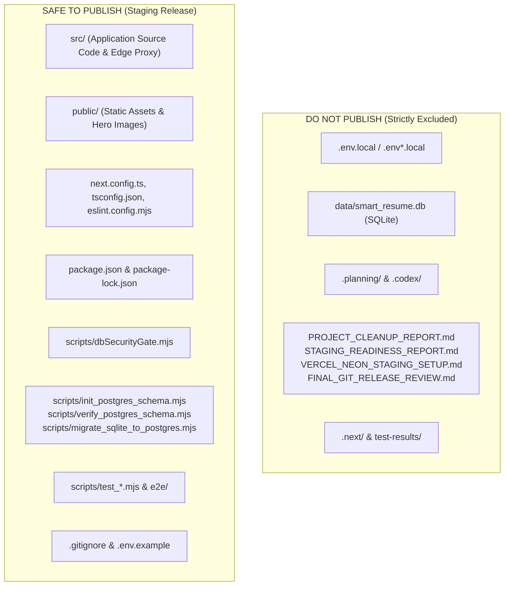

# Final Post-Cleanup Git & Deployment Safety Audit: Smart Resume AI

**Date:** November 6, 2026  
**Repository:** `D:\projects\builder-github`  
**Current Git Branch:** `main` (synchronized with `origin/main` at commit `b16da90`)  
**Target Deployment:** Vercel Staging (Preview) + Neon PostgreSQL Isolated Staging Branch  
**Audit Purpose:** Comprehensive pre-release safety audit verifying file integrity, security isolation, dependency consistency, configuration hygiene, and publication boundaries.

---

## 1. Executive Status & Final Decision

### **FINAL DECISION: READY FOR STAGING RELEASE (VIA TARGETED FILE SELECTION)**

| Verification Area | Status | Findings |
|---|:---:|---|
| **TypeScript Typecheck** | **PASS** | `npx tsc --noEmit` exited with **0 errors**. |
| **ESLint Quality Check** | **PASS** | `npm run lint` exited with **0 errors / 0 warnings**. |
| **Next.js Production Build** | **PASS** | `next build --webpack` successfully compiled **85/85 routes** and Edge middleware proxy (`src/proxy.ts`). |
| **Core Regression Suites** | **PASS** | **100% pass rate** across Auth, Admin, Versioning, Document Validation, Themes, and P0/P1 Security. |
| **Secret & Credential Isolation** | **PASS** | Zero secrets in tracked files or `.env.example`. `.env.local` strictly gitignored. |
| **Database File Protection** | **PASS** | `data/*.db` strictly gitignored. Zero database files tracked in Git. |
| **Legacy Code Deletion References** | **PASS** | Zero workflow, build, or deployment references to deleted Python files or Dockerfile. |
| **Package Consistency** | **PASS** | `package.json` and `package-lock.json` are consistent (`npm ls --depth=0` passed). All 37 script references exist on disk. |
| **Remote Database Safety Gate** | **ACTIVE** | W1–W5 pre-connection guards strictly active. Zero unapproved remote connections possible. |

---

## 2. Git Status & Inventory Analysis

### A. Working Tree Summary
- **Current Branch:** `main` (commit `b16da90`)
- **Local Staging Branch:** `staging` (commit `b16da90`, identical base commit to `main`)
- **Tracked Files Deleted:** 174 files
- **Tracked Files Modified:** 101 files
- **Untracked Items:** 67 items (app files, new test scripts, security gate, planning docs)

### B. Reconciliation with Cleanup Report (`PROJECT_CLEANUP_REPORT.md`)
The actual Git working tree matches the documented cleanup report:
1. **Legacy Streamlit / Python Files Deleted (Tracked):**
   - Root Python scripts: `add_templates.py`, `app.py`, `cleaner.py`, `clean_all.py`, `clean_code.py`, `fix_about.py`, `fix_app.py`, `fix_builder_preview.py`, `fix_dashboard.py`, `fix_job_icons.py`, `fix_markdown.py`, `fix_orphans.py`, `fix_syntax.py`, `refactor_db.py`, `run_app.py`, `setup_chromedriver.py`, `swap_builder.py`, `ui_components.py`.
   - Legacy directories: `config/`, `dashboard/`, `feedback/`, `jobs/`, `legacy_python_pages/`, `resume_analytics/`, `utils/`, `style/`.
   - Container & packaging artifacts: `Dockerfile`, `requirements.txt`, `packages.txt`, `startup.bat`, `startup.sh`, `.devcontainer/devcontainer.json`, `assets/124852522.jpeg`, `assets/logo.jpg`.
2. **Obsolete Root Test Files Deleted (Tracked):**
   - `test_analyzer_and_theme.js`, `test_docx_upload.js`, `test_https_verification.js`, `test_job_search_system.js`, `test_linkedin_provider.ts`, `test_pdf_upload.js`, `test_provider_pipeline.ts`, `test_question_bank_and_admin.js`, `test_real_pdf_file.js`.
3. **Redundant Diagnostic Scripts in `scripts/` Deleted (Tracked):**
   - 60+ one-off debug reproducers, HTML hydration checkers, ad-hoc DOM inspectors, and old benchmark dumps.
4. **Temporary Browser Profile Caches Deleted (Untracked directories):**
   - 39 Chrome and Edge diagnostic profiles (`.chrome_*`, `.edge_*`) verified deleted from disk.
5. **Preserved Critical Files:**
   - [`scripts/reset_fresh_database.mjs`](file:///d:/projects/builder-github/scripts/reset_fresh_database.mjs) remains **completely untouched**.
   - [`data/smart_resume.db`](file:///d:/projects/builder-github/data/smart_resume.db) remains **intact and untouched** (4,501,504 bytes, 486 users, 350 resumes, 191 applications).

---

## 3. Publication Boundaries: What to Publish vs. What Must Remain Local



### A. Files SAFE to Publish to Staging Branch
1. **Core Application Source Files (`src/`):**
   - All modified files under `src/app/`, `src/components/`, `src/lib/`, `src/server/`, `src/types/`.
   - All newly added feature modules:
     - Edge proxy middleware: `src/proxy.ts`
     - Career & Student APIs: `src/app/api/career/`, `src/app/api/student/`, `src/app/api/jobs/nlp-search/`, `src/app/api/jobs/suggestions/`
     - Student workflow pages: `src/app/apply-assistant/`, `src/app/interview-prep/`, `src/app/projects/`, `src/app/faq/`
     - Backend intelligence services: `src/server/services/careerActionEngine.ts`, `src/server/services/careerIntelligence.ts`, `src/server/services/applicationAssistant.ts`, `src/server/services/projectMentor.ts`, `src/server/services/unifiedStudentContext.ts`, `src/server/services/resumeIntelligence.ts`, `src/server/services/chatSafety.ts`
     - Providers & resilience: `src/server/services/jobs/providers/naukriCooldown.ts`, `src/server/services/jobs/searchQuery.ts`, `src/server/services/jobs/suggestions.ts`
     - UI primitives: `src/components/ui/Button.tsx`, `src/components/ui/Input.tsx`, `src/components/landing/ProfessionalLandingPage.tsx`, `src/components/jobs/`, `src/components/cursor/`
2. **Configuration & Project Manifests:**
   - `package.json` and `package-lock.json`
   - `next.config.ts`
   - `tsconfig.json`
   - `eslint.config.mjs`
   - `.gitignore`
   - `.env.example` (verified zero credentials)
3. **Static Assets:**
   - `public/hero-landscape.jpg`
4. **Staging Database Architecture & Safety Gate:**
   - `scripts/dbSecurityGate.mjs`
   - `scripts/init_postgres_schema.mjs`
   - `scripts/verify_postgres_schema.mjs`
   - `scripts/migrate_sqlite_to_postgres.mjs`
   - `scripts/verify_staging_env.mjs`
5. **Curated Regression & Verification Suites:**
   - `playwright.config.ts`
   - `e2e/` (21 Playwright test specs and fixtures)
   - `scripts/run-playwright.mjs`
   - `scripts/test_db_security_gate.mjs`
   - All retained essential test suites in `scripts/test_*.mjs`

### B. Files That MUST REMAIN LOCAL (Never Published)
1. **Secrets & Local Configuration:**
   - `.env.local` — Contains local development keys. Confirmed gitignored (`.gitignore:55:.env.*`).
2. **Local Application Database:**
   - `data/smart_resume.db` — Contains local development records (486 users, 350 resumes). Confirmed gitignored (`.gitignore:60:data/*.db`).
3. **Agent Metadata & Planning Artifacts:**
   - `.planning/` — Local project planning context, roadmaps, and phase state.
   - `.codex/` — Internal assistant execution records.
4. **Local Audit & Review Reports (Keep in local workspace for reference):**
   - `PROJECT_CLEANUP_REPORT.md`
   - `STAGING_READINESS_REPORT.md`
   - `VERCEL_NEON_STAGING_SETUP.md`
   - `FINAL_GIT_RELEASE_REVIEW.md`
5. **Local Test Run & Build Artifacts:**
   - `test-results/` (local test outputs and temporary test database copies)
   - `.next/` (local build output)

---

## 4. Security & Configuration Audit Findings

### 1. Credentials & Secrets Check
- **`.env.example`:** Verified safe. Contains only variable names, descriptive comments, and fake template placeholders (`username:password@ep-staging-branch-pooler...`).
- **Source Code Audit:** Zero hardcoded API keys, JWT secrets, passwords, or connection strings found in `src/` or `scripts/`.
- **Credential Masking:** `scripts/dbSecurityGate.mjs` (`maskDatabaseUrl`) enforces URL parsing to redact passwords and sensitive parameters (`token`, `secret`, `key`, `pwd`, `auth`) before any logging.

### 2. Database Safeguards (W1–W5)
- **Production Protection:** Keywords `prod`, `production`, `main`, `master`, `primary`, `live` are unconditionally blocked in hostnames, database names, and usernames.
- **Flag Enactment:** Remote database operations unconditionally fail closed unless both `TARGET_DB_ENV="staging"` and `CONFIRM_STAGING_TARGET="staging"` are passed.
- **Allowlist Enactment:** Target hostname must match `APPROVED_STAGING_HOST` before any network socket or connection pool is opened.
- **TLS Validation:** Strict public CA verification (`ssl: isLocal ? false : true`) enforced across all adapters and scripts. `rejectUnauthorized: false` has been eliminated.

### 3. Next.js & Vercel Configuration
- **Serverless Bundling:** `serverExternalPackages: ['pdf-parse', 'mammoth', 'pg']` in `next.config.ts` prevents Turbopack/Webpack from misbundling binary or native Node packages.
- **Security Headers:** Strict headers configured for all routes (`Strict-Transport-Security`, `X-Content-Type-Options: nosniff`, `X-Frame-Options: SAMEORIGIN`, `Referrer-Policy: strict-origin-when-cross-origin`, `Permissions-Policy`).
- **Edge Middleware:** `src/proxy.ts` compiles cleanly as the serverless Edge middleware proxy (`ƒ Proxy (Middleware)` in Next.js build output).
- **Vercel Zero-Config:** Standard Next.js structure cleanly aligns with Vercel serverless deployment without requiring legacy custom `vercel.json` overrides.

---

## 5. Broken References & Dependency Integrity

- **`package.json` vs `package-lock.json`:** Fully consistent. `npm ls --depth=0` passed cleanly.
- **Script Target Verification:** Every one of the 37 script references in `package.json` exists on disk. Zero broken targets.
- **Legacy Python / Docker References:** Grep audit confirmed zero build, CI, or deployment scripts reference `Dockerfile`, `requirements.txt`, or `.py` files. (The only textual occurrences are descriptive resume bullet points for students in `careerIntelligence.ts` and `projectMentor.ts`).

---

## 6. Exact Step-by-Step Commands for a Safe Staging-Only Release

> [!CAUTION]
> **NEVER execute `git add .` or `git add -A`.** Doing so would stage untracked audit reports, `.planning/`, and internal metadata into the repository.
> Follow the exact file-targeted commands below to commit and publish cleanly to the isolated `staging` branch.

### Step 1: Stage Only Approved Production & Staging Files

```bash
# 1. Switch to the staging branch
git checkout staging

# 2. Stage core configuration files
git add package.json package-lock.json next.config.ts tsconfig.json eslint.config.mjs .gitignore .env.example

# 3. Stage static public assets
git add public/hero-landscape.jpg

# 4. Stage application source code
git add src/

# 5. Stage database security gate & staging scripts
git add scripts/dbSecurityGate.mjs
git add scripts/init_postgres_schema.mjs
git add scripts/verify_postgres_schema.mjs
git add scripts/migrate_sqlite_to_postgres.mjs
git add scripts/verify_staging_env.mjs

# 6. Stage curated test suites & runner
git add playwright.config.ts
git add e2e/
git add scripts/run-playwright.mjs
git add scripts/test_db_security_gate.mjs
git add scripts/test_*.mjs
git add scripts/test_*.js
git add scripts/test_*.ts
git add scripts/benchmark_dashboard_query.mjs
git add scripts/verify_command_center_integrity.mjs

# 7. Record the deletion of obsolete legacy files (Python, old tests, Docker)
git add -u .devcontainer/ Dockerfile add_templates.py app.py assets/ clean_all.py clean_code.py cleaner.py config/ dashboard/ feedback/ fix_*.py jobs/ legacy_python_pages/ packages.txt refactor_db.py requirements.txt resume_analytics/ run_app.py setup_chromedriver.py startup.* style/ swap_builder.py test_*.js test_*.ts ui_components.py utils/ scripts/
```

### Step 2: Verify Staged Changes Before Committing

```bash
# Verify that ONLY approved files are staged
git status --short

# Confirm that NO .env, .db, .planning, or markdown reports are staged:
# Output must be completely empty:
git diff --cached --name-only | grep -E "(\.env|\.db|\.planning|\.codex|REPORT\.md|REVIEW\.md|SETUP\.md)"
```

### Step 3: Create Staging Release Commit

```bash
git commit -m "feat(staging): deploy Smart Resume AI staging release with W1-W5 database safeguards"
```

### Step 4: Push to Isolated Staging Remote (Requires Approval)

```bash
# Push ONLY to the staging branch on origin:
git push origin staging
```

---

## 7. Summary of Outstanding Items Awaiting User Approval

1. **Remote Staging Host Approval (`APPROVED_STAGING_HOST`):**
   - Review and approve the Neon staging branch endpoint before running `scripts/init_postgres_schema.mjs` or `scripts/migrate_sqlite_to_postgres.mjs`.
2. **Git Commit & Push Execution:**
   - Execute the targeted staging commit commands above only when ready to trigger the Vercel staging preview build.
3. **Phase 2 Authorization:**
   - Proceed to Phase 2 (Authentication, Security & Edge Proxy Validation) once the staging preview build is active.

