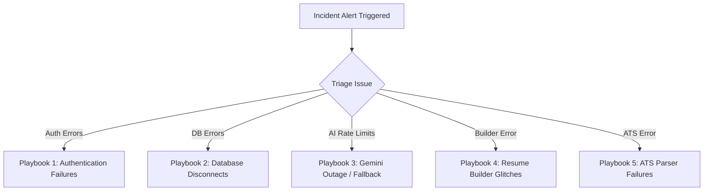

# Smart Resume AI: Incident Response & Operational Triage Guide

This runbook defines standard operating procedures (SOPs) for responding to operational anomalies, outages, and degraded states in production.

---

## 1. Incident Severity Definitions

| Severity | Definition | Target Response | Target Resolution | Examples |
| :--- | :--- | :--- | :--- | :--- |
| **SEV-1 (Critical)** | Core service completely unavailable; widespread data loss or auth failure | < 15 minutes | < 2 hours | Production database unreachable; all logins failing with 500 |
| **SEV-2 (Major)** | Major user feature degraded; workaround available | < 30 minutes | < 6 hours | Gemini AI API outage; PDF generation failing on complex templates |
| **SEV-3 (Minor)** | Non-blocking edge case; isolated to single integration | < 2 hours | < 24 hours | Adzuna external job feed 429; minor style misalignment on rare device |

---

## 2. Incident Playbooks



---

### Playbook 1: Authentication & Session Failures

#### Symptoms
- Users reporting sudden logouts or `401 Unauthorized` errors on previously active sessions.
- Inability to register or login; server logs showing `[Auth Login Error]`.

#### Immediate Diagnostic Steps
1. **Check Server Logs**:
   ```bash
   grep -i "session secret" /var/log/app.log
   ```
2. **Inspect Environment Secrets**:
   - Verify `SESSION_SECRET` and `ADMIN_SESSION_SECRET` are non-empty and ≥ 32 characters in the deployment environment.
   - If secrets were accidentally rotated or truncated during deployment, all prior cookies become invalid.
3. **Verify Database Session Token Store**:
   - Check if the `sessions` table in PostgreSQL has active connections or locked rows.

#### Resolution Actions
- If secrets were altered accidentally, restore the previous `SESSION_SECRET` from cloud secret manager to immediately restore user sessions without requiring relogins.
- If rate limiting is blocking legitimate users (e.g. corporate NAT IP triggered brute-force limit), inspect `src/lib/rateLimit.ts` thresholds or restart the node instance to flush the in-memory window.

---

### Playbook 2: Database Connection & Transaction Failures

#### Symptoms
- `ECONNREFUSED`, `ETIMEDOUT`, or `connection pool exhausted` errors in API routes.
- API endpoints returning HTTP 500 with message `Internal server error`.

#### Immediate Diagnostic Steps
1. **Verify Database Host Reachability**:
   ```bash
   # Test TCP handshake to Neon or PostgreSQL host
   nc -zv ep-pooler.us-east-2.aws.neon.tech 5432
   ```
2. **Check Neon Connection Pool Metrics**:
   - Open Neon Cloud Console → Branches → Metrics.
   - Inspect active connection count vs max compute limit.
3. **Verify SSL Enforcement**:
   - Ensure the connection string includes `?sslmode=require`.

#### Resolution Actions
- If pooled connections are saturated:
  - Verify that `pg.Pool` connection leak is not occurring (all queries must call `client.release()`).
  - Temporarily scale up Neon compute size or increase `PG_MAX_CONNECTIONS` if instance memory allows.
- If primary branch is degraded:
  - Point `DATABASE_URL` to the most recent read-replica or failover branch.

---

### Playbook 3: Google Gemini API Outage or Quota Depletion

#### Symptoms
- Logs displaying `ApiError: 429 Quota Exceeded` or `GoogleGenAIError: 503 Service Unavailable`.
- Student receives message about fallback mode in Career Copilot.

#### Architectural Safeguard Notice
> [!NOTE]
> Smart Resume AI is architected with a **dual-engine intelligence layer**. When `GEMINI_API_KEY` is missing, rate-limited, or returns 5xx errors, the platform automatically switches to the **deterministic local engine** without throwing unhandled exceptions.

#### Resolution Actions
1. **Verify Fallback Operation**:
   - Confirm that ATS Scoring and Career Copilot continue returning deterministic recommendations and scores.
2. **Rotate or Upgrade Gemini API Key**:
   - If quota exhausted, generate a new key at Google AI Studio or attach a billing account to raise rate limits (Tier 1 pay-as-you-go).
   - Update `GEMINI_API_KEY` in deployment environment variables and trigger zero-downtime redeploy.
3. **Check Centralized Prompts**:
   - Check `src/server/prompts/` to ensure no malformed inputs were sent that violated Gemini safety filters.

---

### Playbook 4: Resume Builder or PDF Export Failures

#### Symptoms
- Client-side error when navigating between steps or clicking "Download PDF".
- Print dialog shows blank pages or chopped margins.

#### Immediate Diagnostic Steps
1. **Check Browser Console**:
   - Look for unhandled DOM exceptions during step rendering.
2. **Verify Print Media Query**:
   - Smart Resume AI utilizes `@media print` rules in `globals.css` with `@page { size: A4; margin: 0; }`.
   - Ensure browser zoom is reset (`100%`) or user clicks "Fit" in preview controls.

#### Resolution Actions
- **Client Cache Corrupted**:
  - Ask user to open the builder in an incognito window or clear `localStorage['sra_builder_draft']`.
- **Corrupted Section Data**:
  - Instruct user to remove problematic custom section or reset to sample data.
- **Direct PDF Export Button**:
  - Ensure the user clicks `#toolbar-download-pdf` in the top bar, which triggers `window.print()` with verified print CSS styles.

---

### Playbook 5: ATS Parser & File Extraction Errors

#### Symptoms
- Uploading PDF resume in `/ats-score` returns `Unable to extract text from PDF`.

#### Layered Extraction Diagnostic Steps
Smart Resume AI executes a **3-Layer Fallback Architecture** for document parsing:
1. **Layer 1**: Primary `pdfjs-dist` worker text extraction.
2. **Layer 2**: Secondary Node.js stream buffer decoder.
3. **Layer 3**: High-tolerance deterministic fallback parser.

#### Resolution Actions
- If all 3 layers fail, the PDF is likely an image-only scan without an embedded text layer (OCR required).
- Advise candidate to use the **"Paste Text"** tab on `/ats-score`, which accepts raw plain text and executes the exact same deterministic ATS analysis engine with identical precision.

---

## 3. Post-Incident Review (PIR) Checklist

Within 24 hours of resolving any SEV-1 or SEV-2 incident:
1. Document timeline of events (detection, triage, containment, recovery).
2. Identify root cause (code bug, third-party dependency, configuration drift).
3. Author regression test in `scripts/` to prevent recurrence.
4. Verify all invariants (ATS Hash, 0 horizontal overflow, auth boundaries) remain strictly intact.
