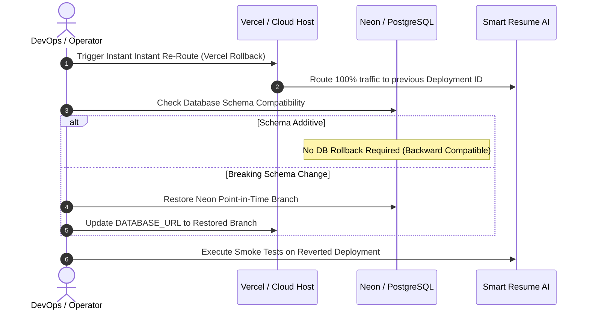

# Smart Resume AI: Rollback & Recovery Guide

This guide establishes the emergency rollback procedures for reverting application code, environment configurations, and database states to a known good release in the event of an unrecoverable production deployment issue.

---

## 1. Rollback Decision Matrix

Execute a rollback if any of the following conditions persist for > 15 minutes post-deployment:
- Core authentication is failing across multiple users (`500 Internal Server Error` on `/api/auth/*`).
- Database migrations corrupted existing candidate resume records or user data.
- Fatal runtime crashes during SSR on the landing page or Resume Builder.
- Deterministic ATS scoring engine returns divergent scores for identical inputs.

---

## 2. Release Rollback Procedure



### 2.1 Vercel Instant Rollback (Zero Downtime)
1. Navigate to **Vercel Dashboard → Deployments**.
2. Locate the previous stable deployment (e.g., `Deployment ID: dpl_xxx`).
3. Click the three dots `...` → **Instant Rollback**.
4. Confirm rollback. Vercel routes 100% of DNS and Edge traffic back to the prior deployment within seconds.

### 2.2 Git / Server-Based Rollback (Self-Hosted / Containerized)
1. Identify the previous release Git commit hash or tag:
   ```bash
   git tag --list "v*"
   # Target previous stable tag, e.g., v1.0.0
   ```
2. Check out the known good release tag:
   ```bash
   git checkout tags/v1.0.0
   ```
3. Re-install dependencies and build:
   ```bash
   npm ci
   npm run build
   ```
4. Restart the service supervisor:
   ```bash
   sudo systemctl restart smart-resume
   ```

---

## 3. Database Rollback Precautions & Procedures

### 3.1 Non-Breaking (Additive) Changes
Smart Resume AI enforces strict **additive-only schema evolution**:
- All new tables and columns must use `CREATE TABLE IF NOT EXISTS` and nullable columns or `DEFAULT` values.
- Existing columns are never dropped or renamed in a minor release.
- **Result**: Code rollbacks DO NOT require rolling back the database schema if changes were strictly additive. The older application code simply ignores newly added columns.

### 3.2 Breaking Data Corruption Procedure (Neon PostgreSQL)
If a catastrophic migration corrupted data in production:

1. **Do NOT run manual DROP TABLE commands**.
2. **Access Neon Console → Branches**:
   - Locate the primary production branch.
   - Use Neon's **Time Travel / Point-in-Time Restore** feature.
   - Select a restore timestamp immediately prior to the deployment execution (e.g., `2026-11-18T19:50:00Z`).
3. **Create New Restored Branch**:
   - Name the restored branch: `production-recovery-<timestamp>`.
4. **Update Environment Secret**:
   - Update `DATABASE_URL` in your deployment settings to point to the new recovery branch pooled URI.
5. **Redeploy and Re-index**:
   - Restart the application. Schema initialization will verify all 31 tables safely.

### 3.3 SQLite Rollback (Local / Self-Hosted Single Instance)
1. Stop the application process:
   ```bash
   sudo systemctl stop smart-resume
   ```
2. Restore the pre-deployment snapshot:
   ```bash
   cp data/smart_resume.db.backup data/smart_resume.db
   ```
3. Start the application:
   ```bash
   sudo systemctl start smart-resume
   ```

---

## 4. Environment Rollback Steps

If an invalid environment variable or corrupted secret caused the incident:

1. **Access Environment Variables Manager**:
   - Vercel: Project Settings → Environment Variables.
   - AWS / Doppler / HashiCorp Vault: Restore secret snapshot.
2. **Restore Values**:
   - Ensure `SESSION_SECRET` matches the pre-incident value (re-enabling existing user sessions).
   - Ensure `NODE_ENV=production`.
3. **Trigger Zero-Downtime Redeployment**:
   - Redeploy the application to propagate updated environment variables to serverless lambda workers.

---

## 5. Post-Rollback Verification Checklist

Immediately following rollback, confirm:
- [ ] Landing page renders with HTTP 200: `curl -I https://app.smartresume.ai/`
- [ ] User login succeeds with existing credentials.
- [ ] Resume Builder loads student's existing drafts without data loss.
- [ ] ATS scoring returns accurate score.
- [ ] Error logs return to baseline (< 0.05% error rate).
- [ ] Post-incident report logged in project tracker.
